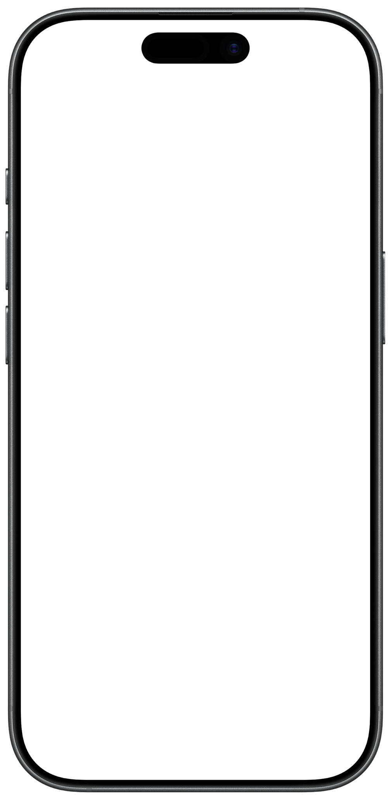

# StrideBuddy — Marketing Website

A single-page landing site for **StrideBuddy**, the iOS training diary for competitive
track-and-field athletes. It is a static site (plain HTML + inline CSS, no build step,
no dependencies, no tracking) styled with the app's **StrideBuddy Design System**
(see `../iOS/docs/DESIGN.md`).

## Files

| File | Purpose |
| --- | --- |
| `index.html` | The one-page landing site (hero, sessions, features, plan, weekly Plan, periodization, session purpose, race predictions, volume, records, races, iPhone and web, how it works, CTA). |
| `it.html` | The Italian homepage (`/it`): the same sections in Italian, with Italian screenshots. Its `<style>` block and campaign script are copies of `index.html`'s; change both pages together. `hreflang` links on both pages and in `sitemap.xml` pair `/` and `/it`. |
| `faq.html` | FAQ (`/faq`), with `FAQPage` JSON-LD that must match the visible answers word for word. |
| `support.html` | Support / contact page. |
| `terms.html` | Terms of use and AI disclosure. |
| `privacy.html` | Privacy policy. The official text. |
| `it/privacy.html` | Italian translation of the privacy policy (`/it/privacy`). It says the English page is the official one, keeps its "Last updated" date, and changes in the same commit as `privacy.html`. Asset and stylesheet paths are absolute because it sits under `/it/`. |
| `legal.css` | Shared paper/ink layout and typography for support, legal, and campaign pages. |
| `s/community/index.html` | Campaign landing page for community links (`/s/community`). Carries `noindex, follow`. |
| `s/campaign.css` | App Store call-to-action styles for the campaign pages. |
| `robots.txt` | The whole crawler policy: allows every crawler, AI ones included, plus the Sitemap line. |
| `serve.py` | Local dev server that strips `.html` like production does. Never deployed. |
| `BingSiteAuth.xml` | Bing Webmaster Tools site verification. Must stay at the site root. |
| `llms.txt` | Plain-text summary for AI assistants ([llmstxt.org](https://llmstxt.org) format). ASCII only. Keep its facts in step with the homepage and FAQ. |
| `sitemap.xml` | The seven indexable URLs, with `hreflang` alternates for `/` and `/it` and for `/privacy` and `/it/privacy`. Must agree with the `rel="canonical"` tags. |
| `assets/` | Brand logos and screenshots. |
| `assets/og-image.png` | 1200×630 share card: `og:image` and `twitter:image` on every English page. See § Share image. |
| `assets/og-image-it.png` | The Italian share card, on `/it` and `/it/privacy`. |
| `assets/screenshots/` | App screenshots used by the landing page. |
| `assets/screenshots/it/` | Italian screenshots for `it.html`. See § App screenshots. |

## Campaign attribution

> **In use. Do not delete any of it.** The inline script in `index.html`, the
> `/s/community` page, `s/campaign.css`, and the `pt`/`ct` parameters on every
> App Store link are each load-bearing, and each is referenced from somewhere
> outside this repository — the Instagram profile, community posts, App Store
> Connect. Removing one breaks nothing visibly: the page still renders, no test
> fails, and that channel's installs quietly start reporting as `website`.
> `AGENTS.md § Campaign attribution` states the rules.

Every App Store link is a campaign link generated in App Store Connect →
Analytics → Acquisition → Campaigns, so installs are traceable there. The links
take the form:

```
https://apps.apple.com/app/apple-store/id6760190939?pt=128627634&ct=<token>&mt=8
```

`pt` is the provider token for the Apple Account and is the same everywhere.
`ct` is the campaign, and each campaign must also exist in App Store Connect
under exactly that name or its installs are not reported. A campaign stays empty
until at least five individual Apple Accounts have installed from it, so an early
zero is a privacy floor rather than a broken link.

### What to share, per channel

Share a page rather than the App Store link anywhere a visitor might be on a
desktop, where an App Store link is a dead end. Every page below carries a token,
so the attribution is the same either way.

| Channel | Share this | Attributes as |
| --- | --- | --- |
| Instagram profile, "Explore StrideBuddy" | `https://stridebuddy.app/?c=instagram` | `instagram` |
| Instagram profile, "Download StrideBuddy" | the `instagram` App Store link below | `instagram` |
| Forums, Reddit, Discord, clubs, coaches | `https://stridebuddy.app/s/community` | `community` |
| Everything else, and organic search | `https://stridebuddy.app` | `website` |

Never share a bare `apps.apple.com` link. It carries no token, and the install is
invisible. Never send channel traffic to the plain homepage either — it tags as
`website` and drains the channel's own number.

### Tagging the homepage with `?c=`

Someone told to "explore" wants the full site, not a landing stub, so the
homepage can carry any campaign's token. Adding `?c=<campaign>` to it rewrites
the `ct` on its App Store links, and an inline script at the bottom of
`index.html` does the rewrite. `it.html` carries a copy, so `/it?c=instagram` works
the same way, and both pages' language switch keeps the `?c=` value.

Only campaigns named in that script's `campaigns` array are accepted, so a
made-up value cannot invent a campaign or repoint the button; anything
unrecognized leaves the links at `ct=website`. Add a channel there when you add
one to App Store Connect. The script reads the URL and sets link attributes, and
that is all it does: no request, cookie, storage, or third party, and nothing
about the visitor is recorded. If it never runs, the links stay `ct=website`.

`/s/community` is the lightweight alternative for somewhere the full homepage is
too much, such as a forum reply. Instagram used to have a matching page and no
longer needs one: its links go to the App Store and to the tagged homepage, so
the page was deleted rather than left unused. Add another `/s/` page only if a
channel wants a landing page of its own; a channel that just needs the homepage
only needs a `?c=` value.

### The three App Store campaign links

```
instagram  https://apps.apple.com/app/apple-store/id6760190939?pt=128627634&ct=instagram&mt=8
community  https://apps.apple.com/app/apple-store/id6760190939?pt=128627634&ct=community&mt=8
website    https://apps.apple.com/app/apple-store/id6760190939?pt=128627634&ct=website&mt=8
```

The `website` link is the one on every App Store button in `index.html` and `it.html`. The other two
are in their landing pages' call to action.

Use the generated link verbatim when adding a channel — note the
`/app/apple-store/` path, which differs from the plain `/app/` product URL.
Attribution comes from the campaign token alone. The site adds no analytics,
cookies, or third-party requests, and it must stay that way — but note that
"no scripts" stopped being literally true: `index.html` carries the inline
campaign script and an inert block of JSON-LD. Both are first-party, neither
makes a request or records anything, and both are deliberate. Judge a proposed
script by whether it tracks, fetches, or adds a dependency, not by whether it
is JavaScript.

## Search indexing

As of 2026-08-11 the site was **absent from Google's index entirely** — a search
for the brand name and its own tagline returned nothing, and `site:stridebuddy.app`
returned nothing. The files below are the fix for the mechanical half of that.
They do not make the site rank; they make it eligible.

### The canonical URL form is apex, no extension

**Cloudflare Pages strips the `.html` extension.** `/support.html` returns a 307
to `/support`, and `/index.html` a 307 to `/`. The extensionless URL is the one
that returns 200, so it is the real URL, and the canonical tags, `sitemap.xml`
and every internal link all name it.

This is not a style preference and getting it backwards is not harmless. A
sitemap listing redirecting URLs is a defect Google reports, and a canonical
pointing at a redirect is a signal that contradicts itself. **The three must
agree; if they ever disagree, the signal is worse than having none.**

**Verify with `curl` and no `-L`.** Following redirects reports the final 200
and hides the hop — that mistake is how this was first written with `.html`
URLs throughout, on 2026-08-11, and shipped that way in `4d67a0a` before being
corrected.

```sh
curl -s -o /dev/null -w '%{http_code} -> %{redirect_url}\n' https://stridebuddy.app/support
```

`www.stridebuddy.app` 301-redirects to apex through a Cloudflare redirect rule
(2026-10-24), keeping the path and query; the canonical tags agree with it.

### robots.txt

`robots.txt` is the whole crawler policy. It allows every crawler, including AI
search and training crawlers (`Content-Signal: search=yes, ai-input=yes,
ai-train=yes`), because being found and recommended by chatbots matters for the
app. Cloudflare's managed robots.txt, Bot Preference Sync and AI-bot blocking
were switched off on 2026-10-24, so nothing is appended. Don't turn them back on
without the user.

### Structured data

`index.html` carries a `SoftwareApplication` JSON-LD block. It is inert JSON —
no execution, no request, no third party — so it does not bear on the
dependency-free rule.

Its `alternateName` is the App Store name, `StrideBuddy: Track & Field`, and the
homepage `<title>` and `og:title` match it. `sameAs` lists the App Store product
URL and the Instagram profile, `https://www.instagram.com/stridebuddy.app/`.

It deliberately omits `aggregateRating`. Google requires rating markup to reflect
ratings genuinely displayed on the page, and the App Store count was 0/0/1 across
`us`/`gb`/`it` on 2026-08-11. Add it only when a real figure exists **and** the
page shows it.

### Search engine verification

`BingSiteAuth.xml` at the site root proves domain ownership to Bing Webmaster
Tools. **Do not move, rename or delete it.** Bing re-checks periodically rather
than once, so removing it un-verifies the property and silently stops the
reporting — the same failure shape as the campaign tokens above.

Its contents are byte-identical to the file Bing generated; leave them alone. The
token inside is *meant* to be publicly served, so it is not a secret and belongs
in Git. Keep it out of `sitemap.xml` — it is not a page.

Google is verified differently and needs nothing in this repository. It uses a
**Domain property** (`sc-domain:stridebuddy.app`), proven by a DNS `TXT` record on
the Cloudflare zone, which is why it covers apex and `www` together while Bing's
covers only the URL it was added under.

**The two consoles are signed in under different identities.** Which one is which
is recorded in the planning repository at `Planning/ACCOUNTS.md`, deliberately not
here: **this repository is public**, and an address written into it is
permanently harvestable. Check there before assuming a console is reachable from
whichever account you happen to be signed in to — the *Import from Google Search
Console* path in Bing failed on 2026-08-12 for what was most likely this reason.

### State as of 2026-08-12

**Google: done.** The Domain property is verified, `sitemap.xml` is submitted, and
URL Inspection reports the homepage `indexed`.

**The site was never missing from Google's index.** That was this work's founding
assumption and it was wrong — the homepage has been indexed since **17 July**,
three weeks before 1.0.4 shipped. It was believed because a `site:stridebuddy.app`
search came back with nothing relevant, from a tool that silently ignores the
`site:` operator. **Check a claim like that against Search Console, which is
Google reporting on itself, rather than against a search box.**

Two things followed from reading the real report. Discovery names
`apps.apple.com` and `appagg.com` as referring pages, so the App Store listing
and the aggregators scraping it are what found the site — tracked as `GROW-010`.
And `Google-selected canonical: Inspected URL` means Google had already resolved
the homepage correctly on its own, so the canonical tag earns its place on the
legal pages and the `www` variants rather than here.

**Bing: verified** 2026-08-12 against `BingSiteAuth.xml`, after the *Import from
Google Search Console* path failed to find the property and the site was added
manually instead.

Bing's is a **URL property**, not a domain one, so unlike Google's it covers only
`https://stridebuddy.app` and not `www`. That is deliberate: a second property for
`www` would split the reporting rather than add to it, and the canonical tags
already point Bing at the apex.

The `www` → apex 301 is a Cloudflare redirect rule, live since 2026-10-24.

### Bing's "Alt attribute for images is missing" is wrong — do not fix it

Bing URL Inspection reports one instance of this on the homepage. It is the
phone bezel in the hero:

```html

```

`alt=""` is not a missing `alt`. It is the standards-required way to mark a
**decorative** image so assistive technology skips it, and `aria-hidden="true"`
says the same thing again. Bing's scanner counts empty alt as absent, which is a
common crawler false positive.

**Giving it descriptive text would be a regression, not a fix.** The bezel is a
frame drawn around a screenshot that already carries its own `alt`; describing it
makes every screen reader announce "iPhone 17 black bezel" over the hero. Leave
it empty. Every other `` on the site has real alt text — that was checked on
2026-08-12, not assumed.

### Share image

`assets/og-image.png` is the link-preview card (`og:image`, `twitter:image`,
`summary_large_image`) on the homepage, FAQ, support, privacy and terms pages.
`assets/og-image-it.png` is the same layout with the Italian tagline *Il diario di
allenamento per l’atletica leggera* and the Italian `today_raw.png` and `review.png`
from `assets/screenshots/it/`; it is on `/it` and `/it/privacy`. It is
1200×630, built with Pillow from repo assets only: `stridebuddy_lockup.png`, the
tagline in SF Pro, and `today.png` in the bezel beside `review.png` on the
`--stage` panel. Like every page image, it is compressed once with `pngquant`
(`--quality=85-98 --speed 1 --strip`). Rebuild it when the lockup or those
screens change.

## Running it

No build needed. Use `serve.py`, not `python3 -m http.server`:

```sh
python3 serve.py 8000
```

**The plain `http.server` 404s on every internal link.** Production strips the
`.html` extension, so the links, the canonical tags and `sitemap.xml` all use
`/support` rather than `/support.html`; `http.server` serves files literally and
finds nothing at that path. `serve.py` adds that one behaviour and nothing else,
so local matches production. It is a development tool and is never deployed.

## Design system

Colors, type, radius, and tone mirror `iOS/docs/DESIGN.md` and the app's Swift
design tokens (`iOS/StrideBuddy/DesignSystem/StrideBuddyColors.swift`): a white
paper page with white cards, ink text, the StrideBuddy red accent (`#DB2412`),
system-sans typography with tabular digits, and the app's 32px card radius. Dark
appearance is the app's: a black page with warm smoke cards, cream ink and the
lifted red. **Light is the default.** Dark is used only when the visitor's device
asks for it through `prefers-color-scheme`; there is no toggle on the page. Do not
introduce a separate web palette — derive from those tokens.

The support, legal and campaign pages share `legal.css`, which still uses the
older warm-brown dark palette. Bring it in line when those pages are next touched.

## App screenshots

The page uses real app screenshots exported with a transparent device frame:

| File | Screen | Used in |
| --- | --- | --- |
| `assets/screenshots/today.png` | Training page (Log a session and the diary) | Hero front phone, and the iPhone and web section (layered inside `assets/iphone-17-black-bezel.png`) |
| `assets/screenshots/review.png` | Plan / Season status and weekly plan | Hero cascade, Plan section (`#coach`) |
| `assets/screenshots/predictions.png` | Insights / 800m performance prediction sheet | Hero cascade, Race predictions section |
| `assets/screenshots/records.png` | Records / personal bests and training records | Hero cascade, Records section |
| `assets/screenshots/race_calendar.png` | Race calendar (upcoming races only) | Hero cascade, Races section |
| `assets/screenshots/central_log.png` | Add a session tray, Log face | Features |
| `assets/screenshots/log_structured.png` | Structured track-session logging | Features |
| `assets/screenshots/log_strength.png` | Strength logging form, filled from the capture diary | Features |
| `assets/screenshots/central_plan.png` | Add a session tray, Plan face | Plan section |
| `assets/screenshots/coach_session.png` | Planned session detail | Session purpose section |
| `assets/screenshots/volume.png` | Insights / volume and predictions | Volume section |
| `assets/screenshots/periodization.png` | Plan setup periodization introduction | Unused on the page; kept in sync with the App Store set |

Every file above is the composite: the raw screen scaled into the device frame,
with the area outside the phone transparent. `today.png` is the one exception.
The page layers the frame over it in CSS, so that file is the bare screen.

**The page files are downsized for loading speed:** composites and
`assets/iphone-17-black-bezel.png` are **1008×2061** (half of the 2015×4120
frame), and `today.png` is **900×1957**. The largest phone on the page is 320 CSS
pixels wide, so this is still about 3× on a retina screen. They are then
compressed with `pngquant` (`brew install pngquant`), which keeps transparency
and shows no visible difference at full zoom. Full size, the page images were
20.5 MB; downsized 7.4 MB; compressed 2.7 MB. The `_raw.png` inputs stay full
size and uncompressed. The `` tags declare 1800×3680, which is the same
aspect at a smaller nominal size and only sets the intrinsic ratio.

Each screen also keeps its unframed capture beside it as `<name>_raw.png`. Those
are the inputs, not page assets: nothing links to them, and they exist so a frame
change does not need the screenshots retaken. Previous versions are archived
under `assets/screenshots/old/`, which is gitignored.

The captures come from the `AppStore/` workspace's capture simulator, using
its fictional diary. `capture --run RUN_ID --website` adds the planning tray and
the strength form, which only the website uses. The frame is applied by
`../AppStore/tools/bezel.py`, which measures the screen window out of the frame
image rather than assuming an offset:

```sh
~/.cache/stridebuddy-social/venv/bin/python ../AppStore/tools/bezel.py \
  assets/screenshots/central_log_raw.png assets/screenshots/central_plan_raw.png \
  assets/screenshots/coach_session_raw.png assets/screenshots/predictions_raw.png \
  assets/screenshots/log_strength_raw.png assets/screenshots/log_structured_raw.png \
  assets/screenshots/periodization_raw.png assets/screenshots/race_calendar_raw.png \
  assets/screenshots/records_raw.png assets/screenshots/review_raw.png \
  assets/screenshots/volume_raw.png --out assets/screenshots --strip-raw
```

**Do not pass `today_raw.png` to it.** That would write a framed `today.png` over
the bare screen the page needs, and the result is a phone drawn inside a phone.
`today.png` is a copy of `today_raw.png`.

`bezel.py` writes full-size 2015×4120 files, so downsize and compress
afterwards. The downsize step leaves files already downsized alone:

```sh
~/.cache/stridebuddy-social/venv/bin/python - <<'PY'
from PIL import Image
import glob
for p in glob.glob("assets/screenshots/*.png"):
    if p.endswith("_raw.png"): continue
    im = Image.open(p); im.load()
    size = {(1206, 2622): (900, 1957), (2015, 4120): (1008, 2061)}.get(im.size)
    if size:
        im.resize(size, Image.LANCZOS).save(p, optimize=True)
PY
for f in assets/screenshots/*.png; do
  case $f in *_raw.png) continue;; esac
  pngquant --quality=85-98 --speed 1 --strip --skip-if-larger --force --ext .png -- "$f"
done
```

Compress only freshly written files: running `pngquant` again on an already
compressed file loses a little more each time.

Keep the same aspect ratio and transparent device treatment when replacing them.

### Italian screenshots

`assets/screenshots/it/` holds the Italian set for `it.html`, made the same way from
`../AppStore/approved/it-IT/sources/` (run `20261024T103032Z-fb2147`): the same file
names, sizes and `pngquant` settings, with `_raw.png` inputs beside them. Run the
commands above from inside that folder. `central_plan.png` and `log_strength.png`
have no Italian capture: `../AppStore/tools/workflow.py` makes the `capture --website`
extras only for `en-US`, so `it.html` uses the English ones until Italian captures
exist. `periodization.png` is not on the page and has no
Italian copy here.

## Contact

`support@stridebuddy.app` is the support, legal, and privacy contact address.
